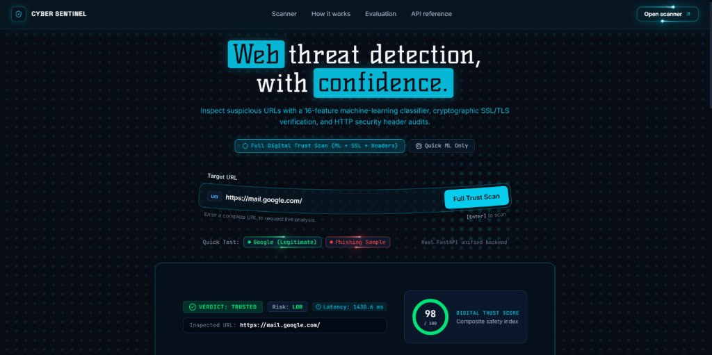
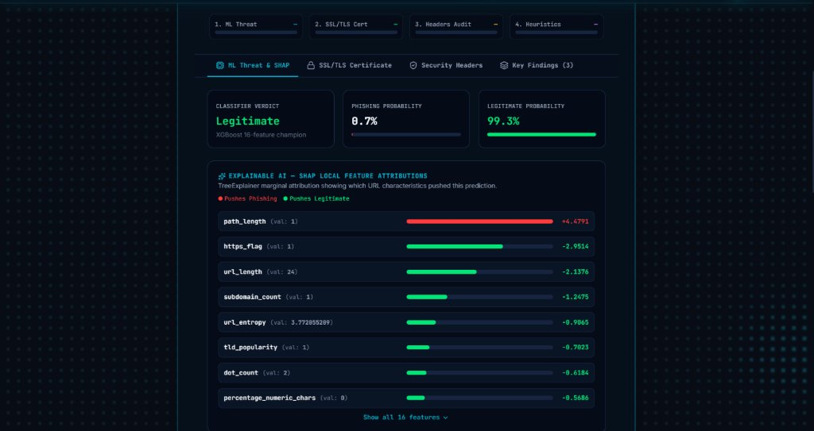
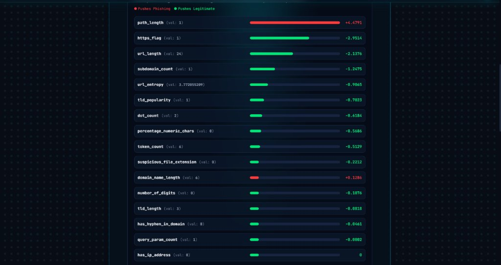

# PhishGuard AI — AI-Powered Web Threat Detection & Digital Trust Intelligence

> An explainable cybersecurity platform that classifies phishing URLs in real time using machine learning, combined with SSL/TLS certificate validation, security header auditing, and a 0–100 Digital Trust Score — deployed as a full-stack React + FastAPI application.

---

## 2. Problem

Traditional phishing detection systems often rely on static blacklists. These can fail to identify newly created, zero-hour, algorithmically generated, or frequently changing phishing URLs.

A URL may also appear trustworthy while having suspicious structural characteristics or weak website-security configurations. Users need more than a simple safe/unsafe label: they need understandable risk indicators and a broader view of a website's security posture.

This project addresses the problem through URL-based machine-learning classification, explainable predictions, and a multi-layer website security assessment platform.

---

## 3. Solution

The platform is designed around four complementary capabilities:

1. **AI-powered URL threat detection** — extracts 16 lexical and structural features from a URL and uses trained Random Forest and XGBoost models to classify it as legitimate or phishing.
2. **Explainable AI** — uses SHAP (TreeExplainer) feature attributions to explain which URL characteristics influenced a prediction, displayed as an interactive waterfall chart.
3. **Website security assessment** — passive checks of HTTP security headers, including HSTS, CSP, X-Frame-Options, and MIME protection.
4. **SSL/TLS validation and digital trust** — full certificate-inspection module (expiry, issuer, cipher, protocol, SAN) combined into a calibrated 0–100 Digital Trust Score.

### Dataset and Evaluation

| Dataset | Samples | Role | Label Convention |
| :--- | :--- | :--- | :--- |
| `LegitPhish_Cleaned.csv` | 100,872 | Primary training and test dataset | `0` = Legitimate (37,380); `1` = Phishing (63,492) |
| `PhiUSIIL_Phishing.csv` | 234,205 | Independent cross-dataset benchmark source | `0` = Legitimate (134,849); `1` = Phishing (99,356) |

The datasets share 36,944 normalized URLs and were not concatenated. The project uses a strict group-aware domain split with zero domain overlap between train, validation, and test sets. Reported result: **99.96% accuracy and 99.99% phishing recall**.

| Metric | Random Forest | XGBoost (Champion) |
| :--- | :--- | :--- |
| **Accuracy** | 99.974% | **99.987%** |
| **Phishing Precision** | 99.969% | **99.989%** |
| **Phishing Recall** | **99.989%** | **99.989%** |
| **Legitimate Specificity** | 99.946% | **99.982%** |
| **F1-Score** | 99.979% | **99.989%** |
| **ROC-AUC** | 1.0000 | **1.0000** |
| **PR-AUC** | 1.0000 | **1.0000** |
| **False Negative Rate** | 0.0105% (1 missed) | **0.0105% (1 missed)** |

For independent PhiUSIIL evaluation: **ROC-AUC 0.9980**, **PR-AUC 0.9986**, and **100.00% legitimate specificity** (0 false alarms among 5,000 legitimate URLs).

> These are dataset evaluation results, not a guarantee of real-world detection performance. SHAP plots and evaluation outputs are stored in `ml/results/`.

---

## 4. Live Demo & Screenshots

- **Project Link** [https://phishguardai-vert.vercel.app/](https://phishguardai-vert.vercel.app/)
- **Live Demo Video** https://drive.google.com/file/d/1nzhkWNr_tWon8pSGAi6t-NJ1XpVr8Fm7/view?usp=drivesdk
- **API backend:** [https://hackmatrix2026.onrender.com](https://hackmatrix2026.onrender.com)
- **API documentation (Swagger):** [https://hackmatrix2026.onrender.com/docs](https://hackmatrix2026.onrender.com/docs)
- **GitHub repository:** [https://github.com/TiyashaPaul2006/HackMatrix2026](https://github.com/TiyashaPaul2006/HackMatrix2026)

### Hero — Full Digital Trust Scan Interface


### ML Threat Assessment & SHAP Explainability Panel


### SHAP Waterfall — All 16 Feature Contributions


---

## 5. Tech Stack

| Area | Technologies |
| :--- | :--- |
| **Frontend** | React 18, Vite, Tailwind CSS, Lucide React, Three.js / WebGL |
| **Backend / API** | FastAPI, Uvicorn, Pydantic v2 |
| **Machine learning** | scikit-learn, XGBoost, Random Forest |
| **Explainable AI** | SHAP (TreeExplainer) |
| **Data processing** | pandas, NumPy, SciPy |
| **Model persistence** | joblib |
| **Security modules** | Python `ssl`, `socket`, `requests`, `re` |
| **Visualisation** | Matplotlib, Seaborn |
| **Testing** | pytest (28 tests — all passing) |
| **Deployment** | Render (backend), Vercel (frontend) |

---

## 6. Architecture

```text
                 [ React Frontend — Vite + Tailwind CSS ]
                 QuickScanBar / HeroSection / FullScanResults
                                  │
                    HTTP POST via centralized api.js service
                     (VITE_API_URL environment variable)
                                  │
                                  ▼
                     [ FastAPI Backend (backend/app.py) ]
                                  │
             ┌────────────────────┼────────────────────┐
             │                    │                    │
             ▼                    ▼                    ▼
      [ ML Threat Engine ] [ SSL/TLS Validator ] [ Security Headers Audit ]
      - 16-feature extractor - Certificate checks  - HSTS / CSP
      - XGBoost champion    - Issuer / expiry     - X-Frame-Options
      - SHAP TreeExplainer  - TLS protocol/cipher - Referrer-Policy
             │                    │                    │
             └────────────────────┼────────────────────┘
                                  │
                                  ▼
                      [ Digital Trust Score (0–100) ]
                      - Weighted composite risk assessment
                      - Risk classification: Critical / High / Medium / Low / Trusted
                      - Actionable security recommendations
```

### URL Feature Extraction

The model uses these 16 URL-derived features, all computed locally without network requests:

1. `url_length`
2. `has_ip_address`
3. `dot_count`
4. `https_flag`
5. `url_entropy`
6. `token_count`
7. `subdomain_count`
8. `query_param_count`
9. `tld_length`
10. `path_length`
11. `has_hyphen_in_domain`
12. `number_of_digits`
13. `tld_popularity`
14. `suspicious_file_extension`
15. `domain_name_length`
16. `percentage_numeric_chars`

SHAP analysis identifies `path_length`, `https_flag`, `url_length`, `subdomain_count`, and `url_entropy` among the leading predictors. These are model explanations, not proof of causation.

---

## 7. Setup and Run Steps

### Requirements

- Python 3.10 or later
- Node.js 18 or later
- The project repository (clone from GitHub — model artifacts are included)

### Install Python Dependencies

```bash
pip install -r requirements.txt
```

### Run a URL Prediction from the Command Line

```bash
# Example legitimate URL
python ml/src/predict.py "https://www.google.com/"

# Example phishing URL
python ml/src/predict.py "https://keraekken-loagginnusa.godaddysites.com/"
```

### Start the FastAPI Backend

```bash
python -m uvicorn backend.app:app --host 127.0.0.1 --port 8000 --reload
```

- API health check: `http://127.0.0.1:8000/health`
- Interactive Swagger docs: `http://127.0.0.1:8000/docs`

### Start the React Frontend

```bash
cd frontend
npm install
cp .env.example .env
# Edit .env and set:  VITE_API_URL=http://127.0.0.1:8000
npm run dev
# Opens at http://127.0.0.1:5173
```

### API Endpoints

| Method | Endpoint | Description |
| :--- | :--- | :--- |
| `GET` | `/health` | Health check — confirms backend is live and model is loaded |
| `GET` | `/` | Service metadata (version, model, features count) |
| `POST` | `/scan` | **Full Digital Trust Scan**: ML + SSL/TLS + Security Headers + Trust Score |
| `POST` | `/predict` | Real-time ML-only threat classification with SHAP |
| `POST` | `/predict/batch` | Classify a batch of URLs |
| `POST` | `/ssl` | SSL/TLS certificate validation and risk audit |
| `POST` | `/headers` | Passive HTTP security header posture assessment |

Example request body for `POST /scan` or `POST /predict`:

```json
{ "url": "https://www.google.com/" }
```

Example request body for `POST /predict/batch`:

```json
{ "urls": ["https://www.google.com/", "https://example.com/"] }
```

### Run Automated Tests

```bash
# Full test suite (28 tests: backend, SSL, headers, full scan flow)
pytest

# SSL/TLS engine only (18 tests)
python -m pytest certificates/test_ssl_validator.py -v
```

### Reproduce Training and Benchmark Evaluation

```bash
python ml/src/train.py           # Train models and regenerate evaluation outputs
python ml/src/evaluate_phiusiil.py  # Run independent PhiUSIIL cross-dataset benchmark
```

---

## 8. Disclosures (Libraries, Templates, AI Tools)

### Libraries and Frameworks

This project uses third-party open-source libraries including scikit-learn, XGBoost, pandas, NumPy, SHAP, FastAPI, Uvicorn, Pydantic, joblib, requests, React, Vite, Tailwind CSS, Three.js, Lucide React, Matplotlib, and Seaborn. Refer to each library's documentation and licence for its terms.

### Templates and External Assets

No specific README, UI, or project template was used. The UI design system (Obsidian Slate colour palette, WebGL DotGrid background, holographic card effects) was developed from scratch for this project.

### AI Tools

The project utilised generative AI developer tools (Google Antigravity / Claude Sonnet & Gemini) to assist with exploratory data analysis, scaffolding boilerplate code, integration, and formatting documentation. All model architectures, data leakage audits, evaluation metrics, SSL/TLS engine logic, and API implementations were empirically verified and executed locally.

### Datasets

`LegitPhish` and `PhiUSIIL` are the dataset sources. Original dataset attribution is retained; datasets are not redistributed in this repository in compliance with their respective terms of use.

---

## 9. Track

**Track:** AI-Powered Threat Detection & Digital Trust Intelligence — HackMatrix 2026

---

## Project Structure

```text
HackMatrix2026/
│
├── frontend/                               # React + Vite frontend (Cyber Sentinel UI)
│   ├── src/
│   │   ├── components/
│   │   │   ├── backgrounds/                # WebGL / animated backgrounds
│   │   │   │   ├── DotGrid.jsx             # Interactive dot-grid WebGL canvas
│   │   │   │   ├── CyberRadarBackground.jsx
│   │   │   │   └── PacketFlowBackground.jsx
│   │   │   ├── common/                     # Reusable UI primitives
│   │   │   │   ├── HoloCard.jsx            # WebGL holographic card
│   │   │   │   ├── SpotlightCard.jsx       # Beam-spotlight glass card
│   │   │   │   ├── CurvedInput.jsx         # SVG curved URL input
│   │   │   │   └── GradientText.jsx
│   │   │   ├── hero/
│   │   │   │   ├── HeroSection.jsx         # Main landing hero + scan trigger
│   │   │   │   └── QuickScanBar.jsx        # URL input bar
│   │   │   ├── landing/
│   │   │   │   ├── ArchitecturalPillars.jsx # Three capability cards
│   │   │   │   └── BenchmarkStats.jsx      # Model performance HUD
│   │   │   ├── layout/
│   │   │   │   ├── Navbar.jsx
│   │   │   │   └── Footer.jsx
│   │   │   └── scanner/
│   │   │       └── FullScanResults.jsx     # Full results dashboard (SHAP, SSL, Headers, Trust Score)
│   │   ├── pages/
│   │   │   └── LandingPage.jsx
│   │   ├── services/
│   │   │   └── api.js                      # Centralized API service layer
│   │   ├── App.jsx
│   │   └── main.jsx
│   ├── .env.example                        # Environment variable template
│   ├── vercel.json                         # Vercel SPA routing config
│   ├── vite.config.js
│   ├── tailwind.config.js
│   └── package.json
│
├── backend/                                # FastAPI unified backend
│   ├── app.py                              # Main API — all endpoints
│   ├── trust_score.py                      # 0–100 Digital Trust Scoring Engine
│   └── test_backend.py                     # pytest: backend endpoint tests
│
├── ml/                                     # Machine learning pipeline
│   ├── src/
│   │   ├── predict.py                      # PhishingDetector class + SHAP inference
│   │   ├── feature_extraction.py           # 16-feature URL extractor
│   │   ├── train.py                        # Model training script
│   │   ├── evaluate_phiusiil.py            # Cross-dataset benchmark
│   │   └── ssl_validator.py                # (legacy — primary is certificates/)
│   ├── models/                             # Inference artifacts (tracked in Git)
│   │   ├── best_model.pkl                  # Champion XGBoost model
│   │   ├── preprocessing_pipeline.pkl      # Fitted scaler / transformer
│   │   └── feature_metadata.json           # Feature names and expected order
│   ├── notebooks/
│   │   ├── 01_dataset_analysis.ipynb
│   │   └── 02_model_training_and_evaluation.ipynb
│   └── results/                            # Evaluation outputs
│       ├── confusion_matrix.png
│       ├── roc_curve.png
│       ├── pr_curve.png
│       ├── feature_importance.png
│       ├── model_comparison.png
│       ├── shap_summary.png
│       ├── shap_importance_bar.png
│       ├── phiusiil_generalization_curves.png
│       ├── phiusiil_confusion_matrix.png
│       ├── classification_report.txt
│       └── evaluation_metrics.json
│
├── certificates/                           # SSL/TLS Certificate Validation Engine
│   ├── ssl_validator.py                    # Full certificate inspection module
│   └── test_ssl_validator.py               # pytest: 18 SSL tests (all passing)
│
├── security/                               # Web Security Headers Auditor
│   └── security_headers.py                 # Passive header assessment engine
│
├── docs/
│   └── images/                             # Application screenshots
│       ├── screenshot-hero.jpg
│       ├── screenshot-scan-results.jpg
│       └── screenshot-shap.jpg
│
├── render.yaml                             # Render deployment config (auto-detected)
├── Procfile                                # Fallback start command for PaaS
├── requirements.txt                        # All Python dependencies
├── .gitignore
└── README.md
```

---

## Current Implementation Status

### ✅ Implemented & Fully Deployed

- 16-feature real-time URL extraction pipeline (zero network requests).
- Baseline Random Forest and champion XGBoost models with **0.0105% False Negative Rate**.
- Zero-leakage group-aware domain split validation (**99.96% accuracy, 99.99% recall**).
- Cross-dataset benchmark on PhiUSIIL (**ROC-AUC: 0.9980, PR-AUC: 0.9986**).
- SHAP TreeExplainer with per-URL local feature attribution (16-value waterfall).
- Complete SSL/TLS Certificate Validation Engine (`certificates/ssl_validator.py`) — SSRF defense, 18/18 pytest tests passing.
- Automated Web Security Assessment Engine (`security/security_headers.py`) — HSTS, CSP, X-Frame-Options, X-Content-Type-Options, Referrer-Policy, Permissions-Policy.
- Calibrated 0–100 Digital Trust Scoring Engine (`backend/trust_score.py`).
- FastAPI backend with endpoints: `/scan`, `/predict`, `/predict/batch`, `/ssl`, `/headers`, `/health`.
- React 18 frontend with full scan results dashboard — prediction, SHAP waterfall, SSL details, header audit, trust score gauge.
- Full-stack integration: frontend ↔ FastAPI ↔ XGBoost + SSL + headers + trust score.
- Full test suite: **28 tests passing** (backend, SSL, headers, full scan flow).
- **Deployed live**: backend on Render, frontend on Vercel.

### 🗺️ Roadmap (Post-Hackathon)

- Domain-grouped K-fold cross-validation for deeper out-of-distribution benchmarking.
- PDF / JSON exportable threat intelligence reports.
- Rate limiting and Redis-backed scan caching for production scale.
- Community collaborative threat intelligence (URL submission and review).
